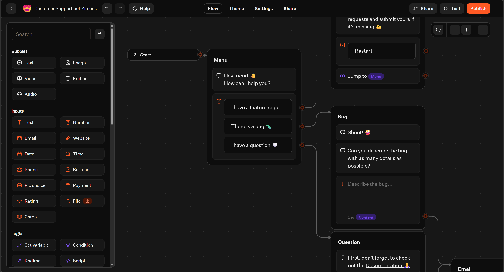
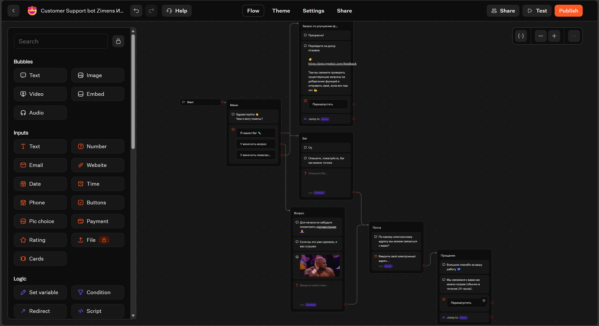
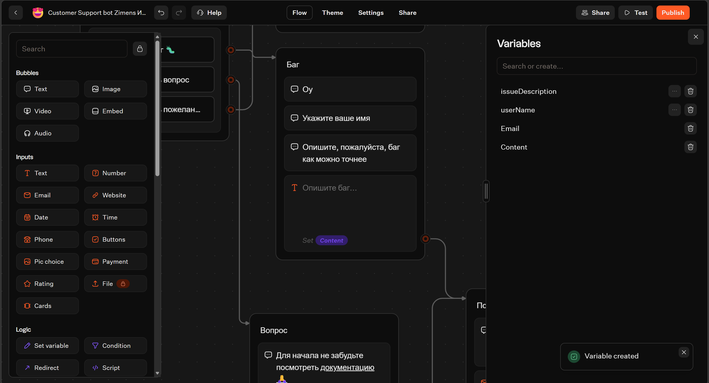
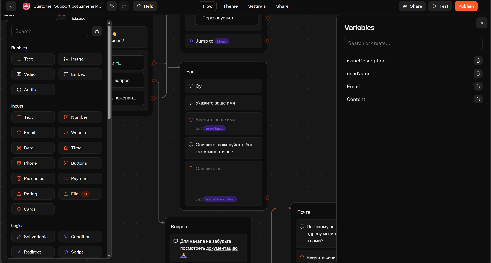
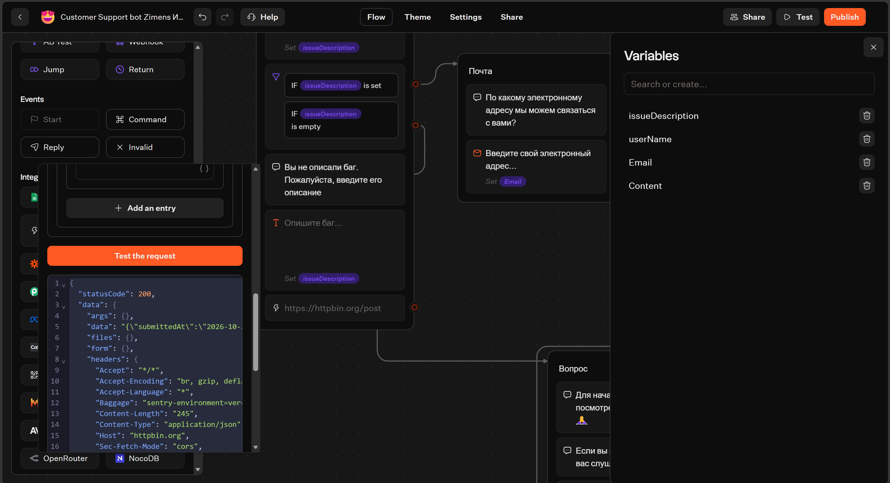
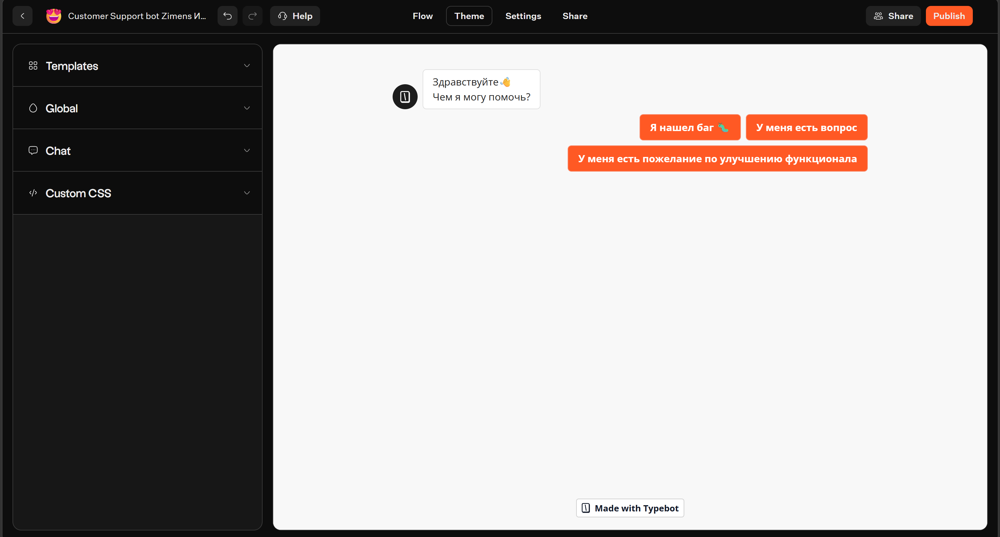
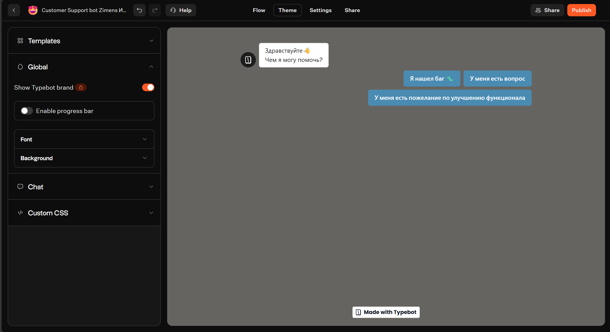
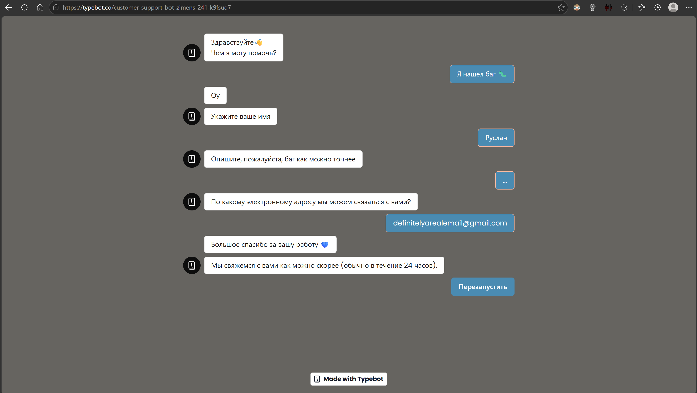
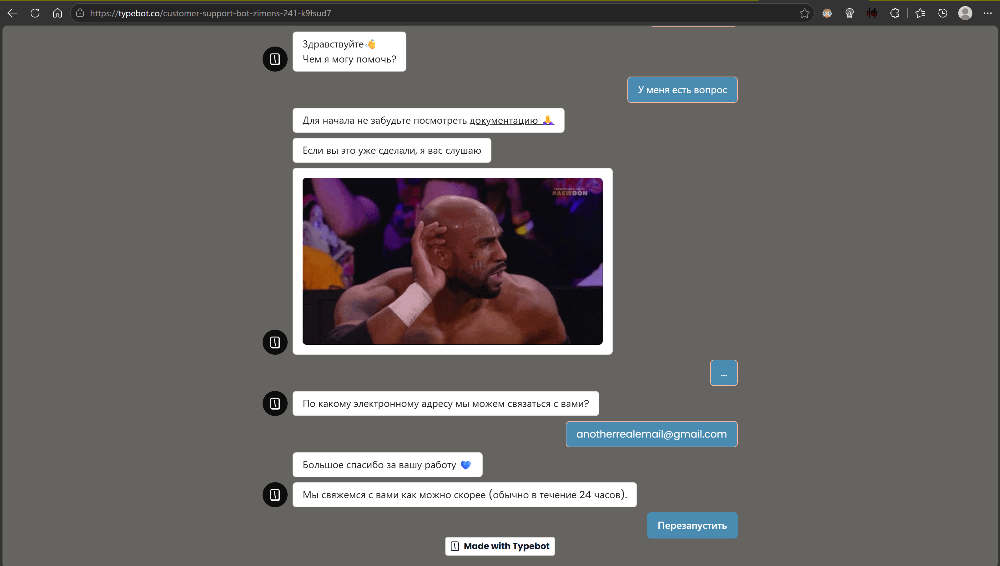
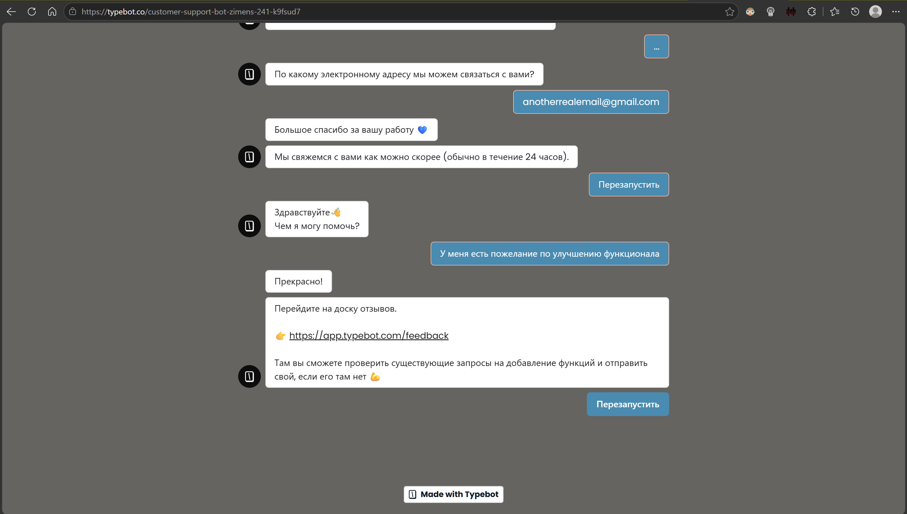

# Лабораторная работа № 5
## Создание чат-бота в Typebot

### 1. Цель работы

Изучить возможности платформы Typebot для создания чат-ботов, освоить работу с блоками, переменными, условиями и HTTP-запросами, а также научиться настраивать оформление и тестировать сценарий диалога.

### 2. Выбранный трек

Выбран трек C — Typebot.

В качестве основы использован шаблон Customer Support Bot, предназначенный для автоматизации первичного взаимодействия с пользователями и обработки обращений в службу поддержки.

### 3. Ход выполнения работы

#### 3.1. Создание и локализация бота

Создан бот на основе шаблона Customer Support Bot. Тексты сообщений и элементы взаимодействия адаптированы на русский язык.

В сценарии предусмотрены варианты обращения: сообщение об ошибке, предложение по улучшению функциональности и вопрос. Также реализованы переходы к дополнительным этапам диалога и завершению взаимодействия.

**Исходный шаблон:**

**Русифицированный сценарий:**

#### 3.2. Добавление переменных и новых шагов

В сценарий добавлены шаги для сбора имени пользователя и описания обнаруженной ошибки.

Для хранения ответов используются переменные `userName` и `issueDescription`. Они позволяют сохранять введённые данные и использовать их в последующих блоках сценария.

Изменён сценарий обработки сообщения об ошибке.

#### 3.3. Настройка условия и HTTP Request

В сценарий добавлен блок Condition для организации условной логики диалога.

Также настроен блок HTTP Request с методом POST и адресом `https://httpbin.org/post`. Данные отправляются в формате JSON.

При тестировании запрос завершился с кодом HTTP 200. Сервис httpbin.org возвращает сведения о полученном запросе, что позволяет проверить передачу данных и работу HTTP-интеграции.

В запросе передаются данные, включая переменные `userName` и `issueDescription`.

Важно отметить, что httpbin.org используется для проверки запроса и не является полноценным хранилищем обращений пользователей.

#### 3.4. Изменение оформления

Изменены тема и шрифт чат-бота. Настройки оформления позволяют адаптировать внешний вид интерфейса к выбранному стилю.

**Первоначальная тема:**

**Изменённая тема и шрифт:**

#### 3.5. Тестирование сценария

Проведено тестирование диалога. Проверены отображение сообщений, ввод ответов пользователем и переходы между этапами сценария.

Результаты тестирования представлены на следующих скриншотах.

### 4. Публикация
Ссылка на опубликованного чат-бота в Typebot: **https://typebot.co/customer-support-bot-zimens-241-k9fsud7**.

### 5. Использованные блоки и освоенные возможности

В ходе работы изучены и использованы следующие возможности Typebot:

- **Text** — отображение текстовых сообщений.
- **Input** — получение ответов пользователя.
- **Variables** — сохранение и использование введённых данных.
- **Condition** — организация условных переходов.
- **HTTP Request** — отправка данных внешнему сервису по HTTP.
- **Theme и настройки оформления** — изменение внешнего вида чат-бота.
- **Publish** — публикация сценария для взаимодействия с пользователями по ссылке.

### 6. Выводы

В ходе лабораторной работы был создан и адаптирован чат-бот для службы поддержки на платформе Typebot. Были освоены локализация готового шаблона, добавление новых шагов, работа с переменными, настройка условной логики и отправка данных внешнему сервису посредством HTTP-запроса.

Также были изменены тема и шрифт интерфейса, проведено тестирование сценария и проверена работа HTTP-интеграции. Полученные навыки позволяют создавать интерактивные диалоги и интегрировать чат-ботов с внешними сервисами.