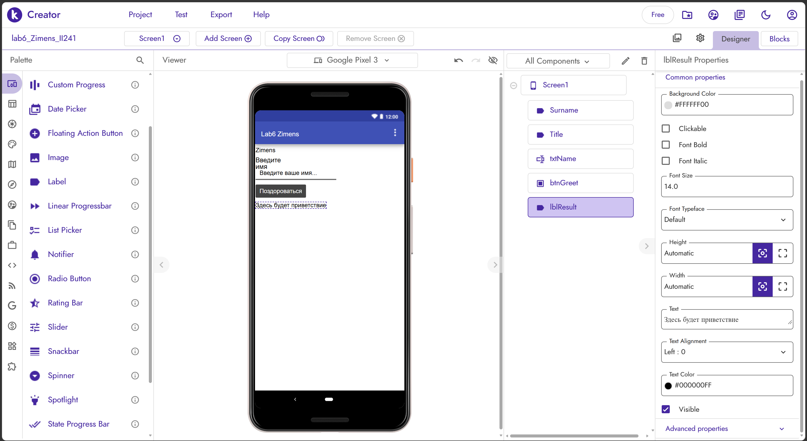
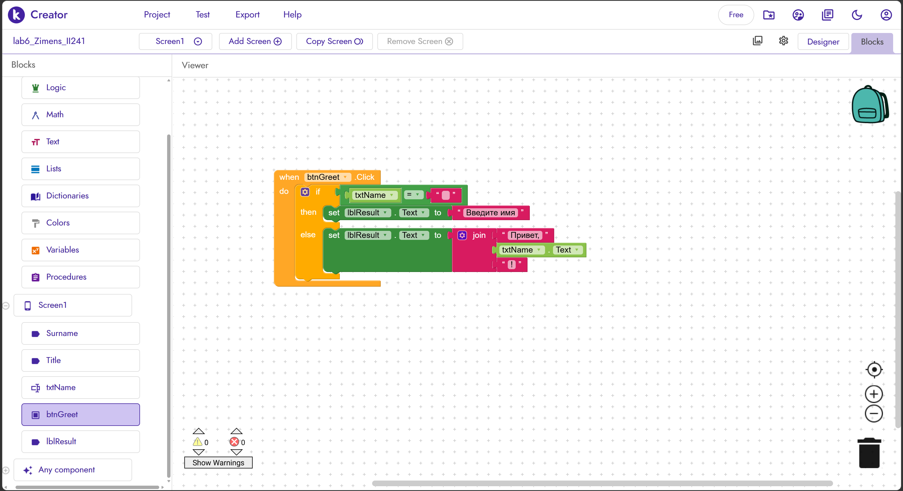
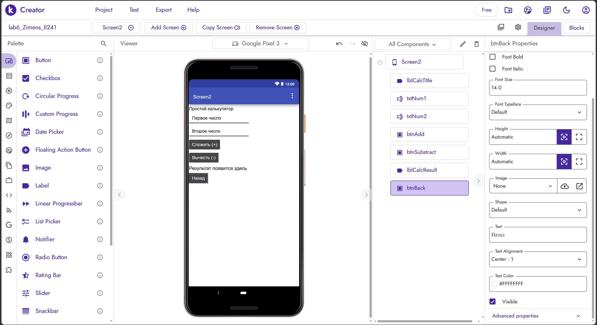
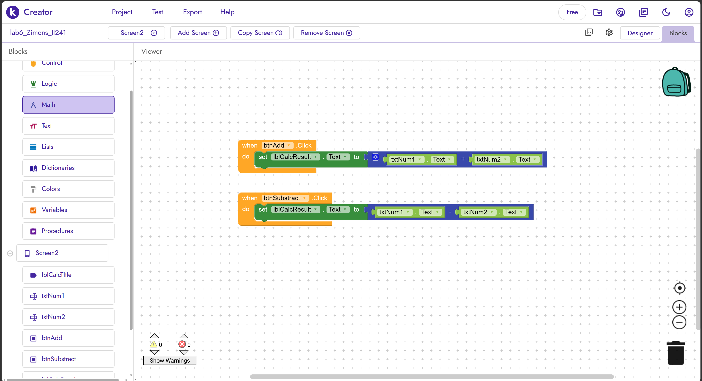

# Лабораторная работа №6. Kodular

## 1. Цель работы

Освоить основы визуального программирования в low-code/no-code платформе Kodular, научиться создавать интерфейс мобильного приложения, использовать визуальные блоки для обработки событий, условия и математические операции.

## 2. Описание приложения

В ходе лабораторной работы создано мобильное приложение, состоящее из двух экранов.

**Screen1 — «Приветствие».**

На первом экране размещены:
- `Label` с фамилией автора `Zimens`;
- `Label` с заголовком «Введите имя»;
- `TextBox` для ввода имени;
- `Button` для запуска приветствия;
- `Label` для отображения результата.

При нажатии на кнопку приложение проверяет введённое значение. Если поле пустое, отображается сообщение «Введите имя!». В противном случае выводится приветствие с введённым именем.

**Screen2 — «Калькулятор».**

На втором экране реализован простой калькулятор, поддерживающий:
- ввод двух чисел;
- сложение двух чисел;
- вычитание второго числа из первого;
- отображение результата;
- возврат на первый экран.

Для реализации использованы стандартные компоненты и встроенные блоки Kodular.

## 3. Реализованные ачивки

### Ачивка 10: Простой калькулятор

Создан второй экран `Screen2`, на котором пользователь может вводить два числа и выполнять сложение или вычитание.

Использованные компоненты:
- `TextBox` — ввод первого и второго числа;
- `Button` — запуск операций сложения и вычитания;
- `Label` — заголовок и отображение результата;
- `Button` — возврат на первый экран.

Использованные блоки:
- обработчики событий `Click`;
- блоки установки свойства `Text`;
- математические блоки сложения и вычитания;
- блоки управления экранами для навигации между экранами.

Ачивка демонстрирует обработку пользовательского ввода, выполнение арифметических операций и вывод результата в интерфейсе.

## 4. Использованные компоненты и блоки

В работе освоены следующие компоненты:
- `Screen` — создание экранов приложения;
- `Label` — отображение текста;
- `TextBox` — ввод данных пользователем;
- `Button` — выполнение действий по нажатию;
- `Screen1` и `Screen2` — организация двухэкранного приложения.

Использованные блоки визуального программирования:
- обработчики событий `when ... Click`;
- условный блок `if then else`;
- блок сравнения `=`;
- блок `join` для объединения строк;
- блоки получения и установки свойств компонентов;
- математические блоки `+` и `−`;
- блоки открытия и закрытия экранов.

## 5. Скриншоты

### 5.1. Первый экран — приветствие

### 5.2. Блоки приветствия

### 5.3. Второй экран — калькулятор

### 5.4. Блоки калькулятора

## 6. Экспорт проекта

Проект создан в Kodular Creator.

Экспорт проекта в формате `.aia` предусмотрен в структуре репозитория:

`lab6/exports/lab6_Zimens_II241.aia`

Ссылка на проект в Kodular Gallery не приводится, поскольку публичная публикация проекта не подтверждена.

## 7. Ограничения бесплатного тарифа Kodular

Работа выполнялась с использованием стандартных возможностей платформы.

В ходе реализации использовались встроенные компоненты и блоки, поэтому устанавливать дополнительные расширения не потребовалось. Ограничения на количество проектов, объём ассетов и количество расширений не препятствовали выполнению данной лабораторной работы.

Отдельная проверка фактического использования лимитов платформы не проводилась.

## 8. Выводы

В ходе лабораторной работы были освоены основы создания мобильных приложений в Kodular с использованием визуального программирования. Был разработан интерфейс приветствия с проверкой введённых данных и создан второй экран с простым калькулятором.

В процессе работы были изучены обработчики событий, условные конструкции, операции со строками, математические блоки и навигация между экранами. Полученные навыки позволяют создавать простые интерактивные приложения без необходимости писать весь программный код вручную.
